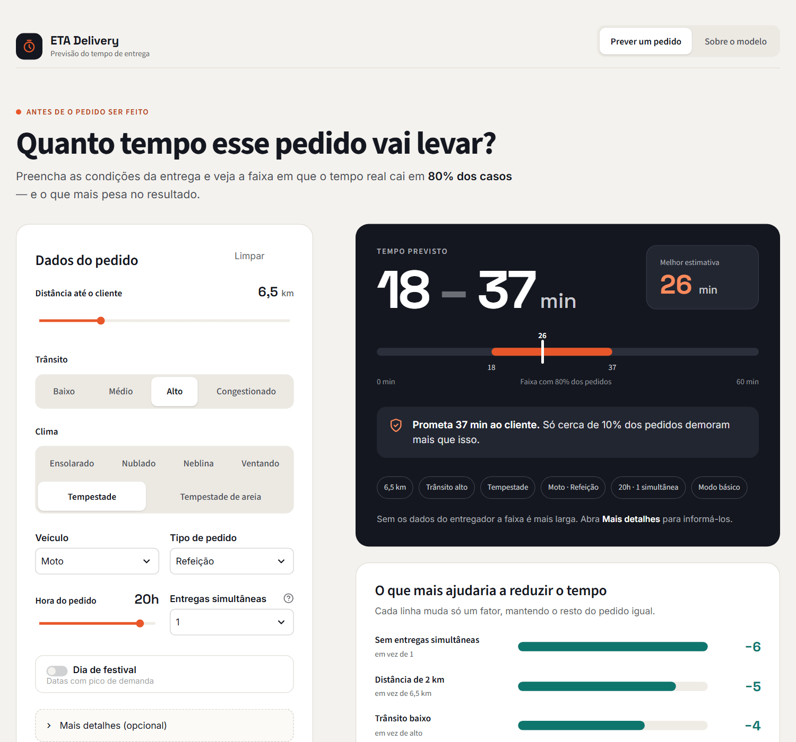
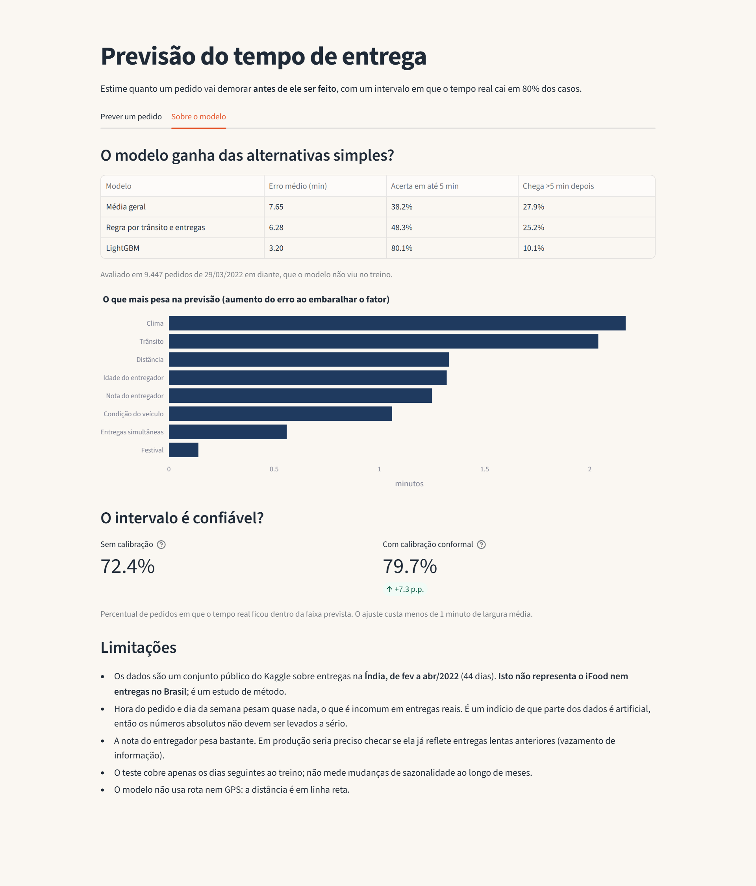

# Previsão do tempo de entrega

Modelo de machine learning que estima **quanto um pedido de delivery vai demorar, antes de ele ser feito**, e devolve não um número solto, mas um **intervalo calibrado**: "entre 21 e 41 min", em que o tempo real cai em 80% dos pedidos. Vem com API (FastAPI) e uma tela de demonstração (Streamlit).

🚀 **[Experimente online](https://previsao-tempo-entrega.streamlit.app/)**



## Por que um intervalo, e não um número

Um app que diz "chega em 32 min" erra para menos em metade dos pedidos. Para o cliente, **chegar depois do prometido é pior do que chegar antes**. Por isso o projeto entrega:

- a **melhor estimativa** (32 min);
- um **intervalo** (21 a 41 min) calibrado para cobrir 80% dos casos;
- a recomendação de **prometer o máximo** (41 min): só cerca de 10% dos pedidos passam dele.

## Resultados

Avaliação em 9.447 pedidos de 29/03/2022 em diante, que o modelo **não viu no treino** (a divisão é por data, não aleatória: treina-se no passado e testa-se no futuro).

| Modelo | Erro médio | Acerta em até 5 min | Chega >5 min depois do previsto |
|---|---|---|---|
| Média geral | 7,65 min | 38,2% | 27,9% |
| Regra por trânsito e entregas simultâneas | 6,28 min | 48,3% | 25,2% |
| **LightGBM** | **3,20 min** | **80,1%** | **10,1%** |

### O intervalo é confiável?

| Intervalo | Acerta (meta: 80%) | Largura média |
|---|---|---|
| Quantis 10%–90% crus | 72,4% | 9,3 min |
| **Calibrado (conformal)** | **79,7%** | 10,1 min |

A regressão quantílica sozinha prometia 80% e entregava 72%. A **calibração conformal** mede esse erro num pedaço separado dos dados e alarga o intervalo na medida certa (+0,41 min de cada lado). A cobertura se mantém perto de 80% em todos os grupos testados: de 78,0% a 81,2% por nível de trânsito, e de 79,0% a 81,0% por número de entregas simultâneas.



## Como funciona

```
dados brutos (Kaggle) ─► limpeza e atributos ─► LightGBM (estimativa)
                                              └► LightGBM quantílico 10% e 90% ─► calibração conformal ─► intervalo
                                                                                          │
                                                       API FastAPI  /prever  ◄────────────┴────────► tela Streamlit
```

1. **Limpeza** (`entrega/dados.py`): corrige latitudes com sinal trocado, trata coordenadas zeradas e notas fora da escala como dado faltante, calcula a distância em km (fórmula de Haversine) e a espera até a coleta (tratando virada de meia-noite).
2. **Bases de comparação** (`entrega/modelo.py`): média geral e uma regra feita à mão. Se o modelo não ganha delas, não vale a complexidade.
3. **Validação por data**: embaralhar misturaria passado e futuro e inflaria os números.
4. **Importância por permutação**: mede quanto o erro piora ao embaralhar cada fator. É mais confiável do que a importância interna do LightGBM.
5. **Intervalo conformal** (`entrega/intervalo.py`): quantis 10% e 90%, calibrados em um conjunto separado (mais recente que o treino, mais antigo que o teste).
6. **Uso** (`entrega/servico.py`): módulo único usado pela API e pela tela, então os dois dão sempre o mesmo resultado. Os modelos ficam em arquivos de texto do LightGBM, que funcionam em qualquer versão de Python.

## Como rodar

```bash
pip install -r requirements-dev.txt

# 1. baixar o dataset (precisa de ~/.kaggle/kaggle.json)
python -m entrega.dados --baixar

# 2. treinar e calibrar (gera os arquivos em modelos/ e resultados/)
python -m entrega.modelo
python -m entrega.intervalo

# 3. usar
streamlit run app.py                    # tela de demonstração
uvicorn entrega.api:app --reload        # API, documentação em http://127.0.0.1:8000/docs
python -m pytest -q                     # testes
```

Os modelos treinados já vêm no repositório (`modelos/`, cerca de 10 MB), então tela e API funcionam sem baixar o dataset nem treinar.

### API

```bash
curl -X POST http://127.0.0.1:8000/prever -H "Content-Type: application/json" \
  -d '{"distancia_km": 18, "transito": "Jam", "clima": "Stormy", "veiculo": "scooter",
       "tipo_pedido": "Meal", "hora": 20, "entregas_simultaneas": 2, "nota_entregador": 4.2}'
```

```json
{"previsao_min": 38, "minimo_min": 29, "maximo_min": 48, "texto": "entre 29 e 48 min", "cobertura_pct": 80}
```

- Só 6 campos são obrigatórios (distância, trânsito, clima, veículo, tipo de pedido, hora). Os demais são opcionais; **quanto menos informação, mais largo o intervalo**.
- Valores impossíveis (hora 24, nota 6, distância negativa, categoria inventada, campo desconhecido) são recusados com erro 422.
- Sem modelo treinado, a API sobe e responde 503 explicando o que rodar.

## Testes

34 testes (`python -m pytest -q`), sem precisar do dataset:

- **Limpeza**: conversão de textos, coordenadas inválidas, espera que passa da meia-noite, fórmula de distância contra um valor conhecido, divisão por data sem misturar passado e futuro.
- **Métricas e bases**: separação entre chegar antes e chegar depois, comportamento da regra com combinação nunca vista.
- **Calibração**: com dados simulados, um intervalo estreito demais passa a cobrir de fato 80% dos casos novos.
- **API**: respostas coerentes (mínimo ≤ estimativa ≤ máximo), validação de entradas, 503 sem modelo.
- **Persistência**: o modelo salvo e recarregado dá exatamente o mesmo resultado que o original.

## Limitações

- **Os dados não são do Brasil nem de uma plataforma específica.** São um conjunto público do Kaggle ([Food Delivery Dataset](https://www.kaggle.com/datasets/gauravmalik26/food-delivery-dataset)) sobre entregas na Índia, de fev a abr/2022 (44 dias). O projeto é um estudo de método, e os números absolutos não se transferem para outro contexto.
- **Parte dos dados parece artificial.** A hora do pedido e o dia da semana pesam quase nada, o que é incomum em entregas reais.
- **A nota do entregador pesa bastante.** Em produção seria preciso checar se ela já reflete entregas lentas anteriores (vazamento de informação).
- O teste cobre apenas os dias seguintes ao treino: não mede mudanças de sazonalidade ao longo de meses.
- A distância é em linha reta, sem rota nem GPS.
- O arquivo do dataset **não é redistribuído** aqui (licença "other"); ele é baixado pelo comando acima.

## Estrutura

```
entrega/dados.py       carga, limpeza e atributos
entrega/modelo.py      bases, LightGBM, validação por data, importância por permutação
entrega/intervalo.py   quantis + calibração conformal
entrega/servico.py     salvar/carregar modelos e prever (usado pela API e pela tela)
entrega/api.py         FastAPI
app.py                 tela Streamlit
modelos/               modelos treinados (texto) e metadados
resultados/            métricas em JSON
tests/                 testes
```

## Tecnologias

Python · pandas · scikit-learn · LightGBM · FastAPI · Streamlit · Plotly · pytest
